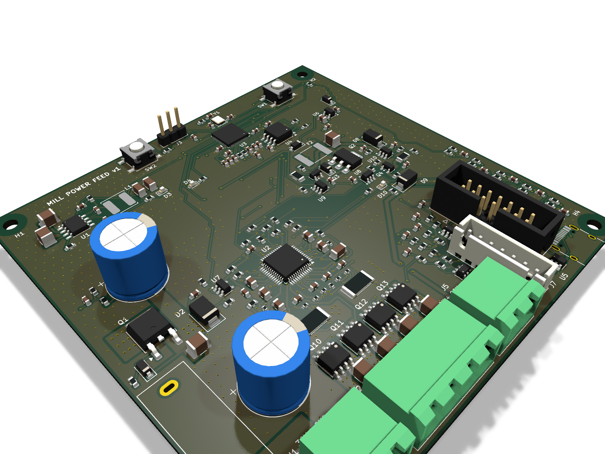

# power-feed-manual-mill

A stepper-motor X-axis power feed for a **SIEG X3.5D** mill.

## Features
- **Speed:** a speed dial and an OLED showing mm/min.
- **Mode switch** (3 positions): LEFT, STOP, RIGHT.
- **Rapid traverse button.**
- **Clutch:** a home-made **electromagnetic tooth clutch**. With the switch on STOP the handwheel turns freely, as it does with no power.
- **Safety:**
  - a hardware E-stop interlock;
  - limit switches;
  - stall detection from an encoder on the leadscrew.



## What is where

| Folder | What | Start here |
|---|---|---|
| `docs/` | The spec, plus notes about the mill | `docs/design.md`, `docs/mill.md` |
| `hardware/` | KiCad 9 schematic + 4-layer 100×100 mm PCB, order files | `hardware/README.md`, `hardware/fab/README.md` |
| `firmware/` | Rust firmware for the RP2040 (Embassy). Core logic is unit-tested on the PC | `firmware/README.md` |
| `mechanical/clutch/` | Tooth clutch: parametric CAD + machining sheet | `mechanical/clutch/MACHINING.md` |
| `mechanical/feed_unit/` | The whole power feed in one box at the left table end: plate, 2:1 belt, leadscrew stub, encoder, clutch module, motor, controller PCB and control panel | `mechanical/feed_unit/FEED_UNIT.md` |
| `mechanical/viewer/` | Interactive 3D view of everything (`sh mechanical/viewer/build.sh`) | `mechanical/README.md` |

## Status

| Part | State |
|---|---|
| Schematic | Done: bare RP2040 (flash, crystal, USB-C with ESD, 3.3 V LDO), TMC5160 power stage, clutch driver, E-stop interlock. ERC clean, netlist checked, independently reviewed |
| PCB | **Ready to order.** 4 layers, 100 × 100 mm. Independently reviewed over 4 rounds (power stage, RP2040 layout, assembly). DRC 0 errors with schematic parity (11 cosmetic silkscreen warnings). Gerbers, BOM, CPL in `hardware/fab/` |
| Firmware | Builds for the RP2040. Core state machine has 47 passing tests. Needs bench commissioning (`firmware/README.md`) |
| Clutch CAD | Ready to machine, after you measure the motor shaft length. Independently reviewed for fit and for machinability on a 3-axis CNC + manual lathe/mill (teeth: one 60° chamfer-mill pass per flank). Magnetic sizing must be bench-calibrated |
| Feed unit CAD | Structure reviewed: Oldham drive, circlip bearing stack, encoder adapter, guard, drawbolt tensioner. **Mill-side dimensions are placeholders until measured** |
| Housing (one box: drive + PCB + controls) | **Ready to print.** Compact, rounded PETG (116 × 187 × 207 mm): a shell + a hood with the controls, each one print on a Prusa MK3S with no supports; the PCB lies above the motor. Independently reviewed (printability, assembly, tool access, plugs, inserts). See FEED_UNIT.md → "Housing" |

## What you need to do

1. **Measure the mill** (`docs/mill.md` → "Unknown"):
   - leadscrew pitch;
   - the left leadscrew end and its drive slot;
   - where the plate can bolt to the table end;
   - clearances at full travel.

   Enter the values in `mechanical/feed_unit/feed_unit.py` (class `F`) and re-run it.
2. **Measure the motor:** shaft length beyond the flange and the pilot diameter. Set them in `mechanical/clutch/clutch.py` (class `P`).
3. **Order the PCB:**
   - upload `hardware/fab/power-feed-gerbers.zip` to JLCPCB: 4 layers, 1.6 mm, 1 oz outer copper (standard; 2 oz breaks the fine-pitch spacing);
   - stencil plus the BOM/CPL for assembly, or reflow it yourself;
   - everything is SMD on the top side, including the RP2040 (QFN-56, 0.4 mm pitch: use the stencil);
   - hand-solder only the SWD header J3, and trim its pins flush underneath (they face the motor);
   - USB-C (J4) shell pegs: solder from below with little solder, fit the panel IDC header J6 last and check it sits flat.
4. **Make the clutch** (`MACHINING.md`). Check the mated teeth (pole gap 0.15 ± 0.05), then calibrate on the bench: pull force and
   cam-out torque against hold current.
5. **Print the housing** (shell + hood, PETG on the MK3S; `FEED_UNIT.md` → "Housing") and machine the feed-unit parts (`FEED_UNIT.md`).
6. **Flash and commission:** follow `firmware/README.md` → *Commissioning*, in order, before mounting on the mill.

## Rebuilding things
```sh
python3 hardware/tools/check_schematic.py                 # schematic: ERC + netlist check
python3 hardware/tools/check_pcb.py                       # PCB: DRC + schematic parity
(cd firmware/feed-core && cargo test)                     # logic tests
(cd firmware/feed-app && cargo build --release)           # firmware
mechanical/.venv/bin/python mechanical/clutch/clutch.py   # clutch CAD (+ machining sheet)
mechanical/.venv/bin/python mechanical/feed_unit/feed_unit.py
mechanical/.venv/bin/python mechanical/tools/check_clutch.py      # interference, engaged + released
mechanical/.venv/bin/python mechanical/tools/check_feed_unit.py   # interference, incl. bolt heads over the tension slot
mechanical/.venv/bin/python mechanical/tools/check_machinable.py  # no sharp internal corners a cutter can't make
```

Create the Python environment for the CAD scripts first:

```sh
python3 -m venv mechanical/.venv
mechanical/.venv/bin/pip install build123d trimesh pyvista shapely networkx
```
