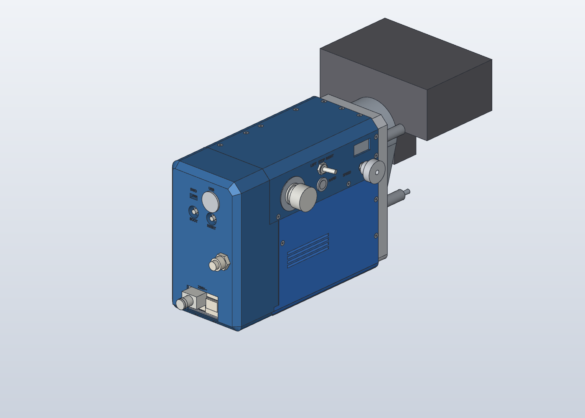
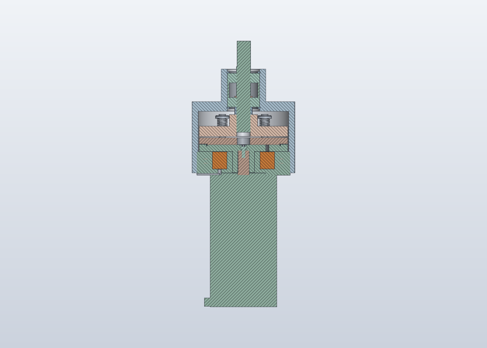
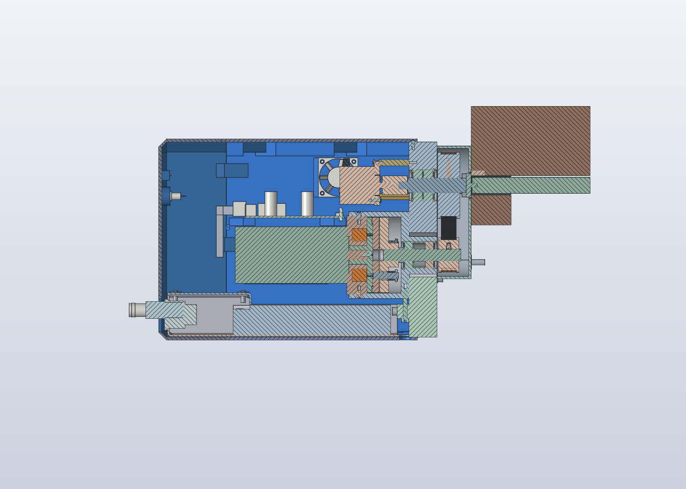

# Mechanical models (SolidCraft)

The CAD is a [SolidCraft](https://solidcraft.io) project in `mechanical/solidcraft/`: every part its own parametric
design (`parts/<group>/<name>.json`), and two assemblies that link them, `clutch.sc` and `feed_unit.sc`. Open them in
the SolidCraft app (0.40 or later). How to edit, rebuild, check, render and export: `mechanical/solidcraft/README.md`.

There is ONE box: the motor, clutch, belt drive, encoder, controller PCB and the controls all live in the feed-unit
housing on the table end (the separate controller box and pendant were retired; see git history before 2026-10-20).
The build123d model (Python) that the SolidCraft project replaced, its checks and the browser viewer are in git
history before the migration.

## Clutch (`solidcraft/clutch.sc`, parts in `solidcraft/parts/clutch/`)
The DIY electromagnetic tooth clutch, modelled engaged (docs/design.md §7). `armature_stroke` drives it to released.
- **Machining:** `clutch/MACHINING.md`, the dimension and fit tables for the lathe and CNC.
- **Measure first:** set `shaft_len` to your motor's actual shaft length (`parts/clutch/rotor.json` and
  `parts/bought/motor_23hs45.json`), and check the pilot diameter.

## X feed unit (`solidcraft/feed_unit.sc`)
The mount for the left table end of the SIEG X3.5D:
- standoffs from the table end;
- a belt chamber closed by a printed guard cup;
- a 28 mm aluminium plate holding a leadscrew stub on 2× 6002 bearings (through bore, circlips, spacer tube);
- a steel or bronze Oldham disc between the stub and the leadscrew slot, so the plate needn't sit exactly on the leadscrew axis;
- HTD-5M 20T/40T pulleys with a 295 mm belt (2:1, centre distance 70.71 mm);
- the clutch module bolted to the plate through its cover's front wall, slotted for belt tension, with a drawbolt tension block;
- the output encoder on an adapter disc and three posts, coupled to the stub's outer end;
- **the housing around all of it, compact and rounded, 3D printed (PETG, fits a Prusa MK3S):** the PCB lies flat
  above the motor; a shell print (walls + PCB rails, heat-set inserts) screws onto the plate edges, and a hood print
  (top + control strip: E-stop, LEFT/STOP/RIGHT, RAPID, OLED, SPEED dial) lifts off to expose the PCB.
  USB-C and the cable glands are in the end wall. Details in `feed_unit/FEED_UNIT.md` → "Housing";
- the earthed, folded-aluminium mains tray (sheet-metal parts; flat patterns in `solidcraft/flat/`).

Every bought part (motor, pulleys, toothed belt, encoder, PSU, inlet, cord plug, E-stop, toggle, buttons, dial, OLED,
gland, fan, USB-C panel end) is one that Amazon.com ships to Israel, modelled from its listing's drawing
(`solidcraft/parts/bought/`; FEED_UNIT.md "Buy" names each listing). Screws, nuts, washers and the bearings are
SolidCraft's ISO library parts.

**Checks:** `python3 mechanical/solidcraft/tools/check.py`: interference (clutch engaged and released, the whole unit),
mains separation, the door's swing and print-bed fit. Re-run after changing a part.

**The mill-side dimensions are PLACEHOLDERS:** the leadscrew-end slot, the standoff positions on the table end, and the
motor angle. See `solidcraft/README.md` → "Measure first", `FEED_UNIT.md` and docs/mill.md.

